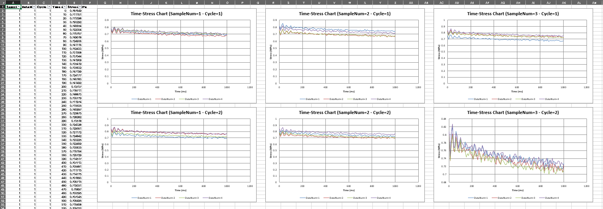
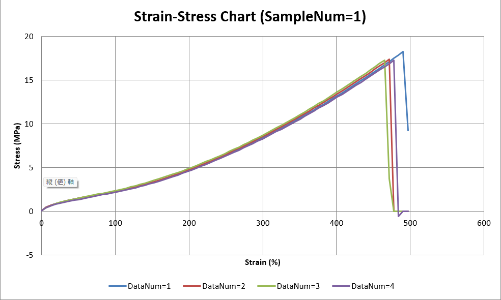
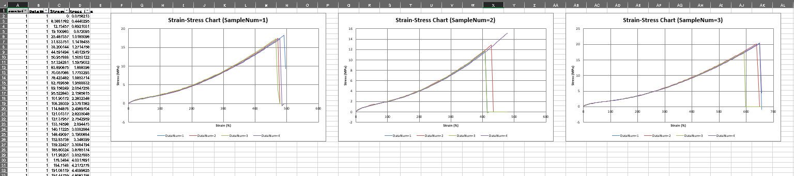
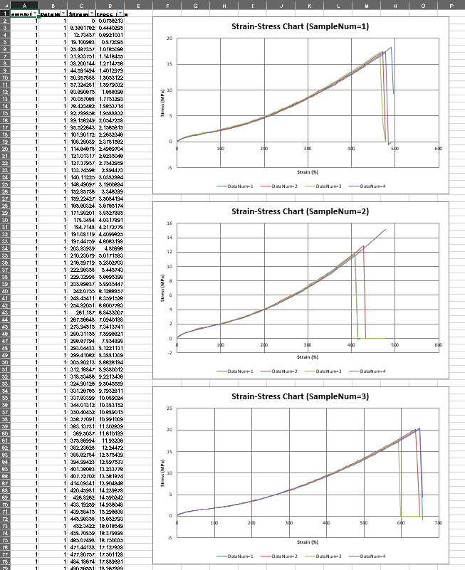

# OpenpyxlChartKit

<p align="center">
  
</p>

**OpenpyxlChartKit** は、`openpyxl` を利用した Excel グラフ作成を、宣言的（Declarative）に記述できる Python ライブラリです。

通常の `openpyxl` では `Chart`・`Series`・`Reference` を個別に生成する必要がありますが、本ライブラリでは **ChartSpec** を定義するだけで複雑なグラフを作成できます。

---

# 特徴

- 宣言的な API によるグラフ作成
- Scatter Chart / Bar Chart に対応
- Series の自動グループ化
- Horizontal Chart Grouping
- Vertical Chart Grouping
- Two-Dimensional Chart Grouping
- グラフサイズに応じた自動レイアウト
- openpyxl ベースの Excel 出力

---

# 従来の openpyxl との違い

通常の openpyxl では

- Chart の生成
- Reference の生成
- Series の追加
- レイアウト計算
- グラフ配置

などを個別に実装する必要があります。

OpenpyxlChartKit では

```python
spec = ChartSpec(...)

ChartRenderer().render(workbook, spec)
```

だけでグラフを生成できます。

「どのように作るか」ではなく、

**「どんなグラフを作りたいか」**

を記述できることを目的として設計しています。

---

# インストール

```bash
git clone https://github.com/JunKjpn/OpenpyxlChartKit.git

cd OpenpyxlChartKit

pip install -e .
```

---

# Quick Start

```python
from openpyxl import load_workbook

from openpyxl_chartkit import (
    AxisSpec,
    ChartRenderer,
    ChartSpec,
    LayoutSpec,
    SeriesSpec,
)

workbook = load_workbook("sample.xlsx")

spec = ChartSpec(
    source_sheet="Sheet1",
    output_sheet="Sheet1",

    chart_type="scatter",

    x=AxisSpec(
        column="Strain %",
        title="Strain (%)",
    ),

    series=(
        SeriesSpec(
            y=AxisSpec(
                column="Stress MPa",
                title="Stress (MPa)",
            ),
        ),
    ),

    layout=LayoutSpec(
        width=20,
        height=15,
    ),

    title_template="Stress-Strain Chart",
)

ChartRenderer().render(workbook, spec)

workbook.save("output.xlsx")
```

---

# 機能紹介

## Series Grouping

指定した列ごとに複数の Series を自動生成します。

```python
SeriesSpec(
    grouping=GroupingSpec(
        columns=("DataNum",),
    ),
)
```

<p align="center">
  
</p>

---

## Horizontal Chart Grouping

指定した列ごとにチャートを横方向へ並べます。

```python
ChartSpec(
    horizontal_grouping=GroupingSpec(
        columns=("SampleNum",),
    ),
)
```

<p align="center">
  
</p>

---

## Vertical Chart Grouping

指定した列ごとにチャートを縦方向へ並べます。

```python
ChartSpec(
    vertical_grouping=GroupingSpec(
        columns=("Cycle",),
    ),
)
```

<p align="center">
  
</p>

---

## Two-Dimensional Chart Grouping

Horizontal Grouping と Vertical Grouping を組み合わせることで、
2次元レイアウトを自動生成できます。

```python
ChartSpec(
    horizontal_grouping=GroupingSpec(
        columns=("SampleNum",),
    ),

    vertical_grouping=GroupingSpec(
        columns=("Cycle",),
    ),
)
```

<p align="center">
  
</p>

---

# レイアウトエンジン

グラフサイズから配置位置を自動計算し、
複数チャートでも重ならないように配置します。

```python
LayoutSpec(
    width=20,
    height=12,
    placement="right_up",
)
```

チャート数を意識することなくレイアウトできます。

---

# サンプル

examples フォルダにはライブラリの利用例を用意しています。

| Example | Description |
|---------|-------------|
| strain_stress.py | 応力-ひずみ曲線 |
| time_stress.py | 時系列応力データ |

サンプルデータは

```
samples/
```

に含まれています。

---

# 設計思想

OpenpyxlChartKit は次の3点を重視しています。

### Declarative

実装ではなく仕様を書く。

### Minimal

最小限の API でグラフを作成できる。

### Composable

Series・Grouping・Layout を自由に組み合わせられる。

---

# 現在の実装状況（v0.1）

- ✅ Scatter Chart
- ✅ Bar Chart
- ✅ Series Grouping
- ✅ Horizontal Chart Grouping
- ✅ Vertical Chart Grouping
- ✅ Two-Dimensional Chart Grouping
- ✅ Automatic Layout Engine

---

# 今後追加予定

- Pie Chart
- Line Chart
- Color Theme
- Secondary Axis
- Trendline
- Legend Customization

---

# ライセンス

MIT License